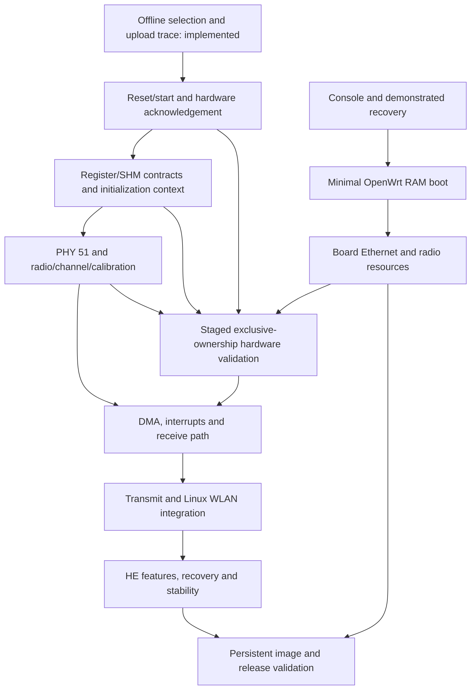

# AX10 v2 implementation roadmap

Updated 2026-10-15. Read [PROGRESS.md](PROGRESS.md) for the current checkpoint and
exact next task. This document describes the complete intended project; unchecked
work is a plan, not implemented support. Milestones have acceptance criteria
rather than speculative completion percentages or delivery dates.

## Objective and target

Build a maintainable modern OpenWrt port for **TP-Link Archer AX10 hardware
v2.0**, including board support and a working replacement for the BCM63178
5 GHz radio driver. Preserve board calibration, regulatory constraints and a
demonstrated recovery route. Keep original code/evidence reviewable and private
device material outside this public repository.

The recorded target is ARMv7 BCM63178/BCM963178, 256 MiB declared RAM, D11
core 130.1, PHY type `0xb`/revision 51.0, PCI `14e4:f6ca`. The separate 2.4 GHz
radio is BCM43217, core 30/NPHY 17, PCI `14e4:a8db`. Exact observations and their
scope are in [the hardware inventory](findings/HARDWARE_INVENTORY.json).

The reference driver is stock `wl` 17.10.121.37. The published GPL archive has
older 17.10.86.5 support source and prebuilt closed core objects. They are
comparison inputs, not interchangeable firmware/table versions. A vendor-kernel
fork retaining proprietary modules would be a separate deliverable; it would not
complete this modern OpenWrt/replacement-driver objective.

## Development order

**Current priority: offline 5 GHz driver development.** UART equipment and a
working modern-kernel boot are not required to continue static analysis and
simulation. Hardware execution has additional dependencies; writing a simulator
does not satisfy them.

The graph shows dependencies, not permission to execute hardware operations.
Offline work on later interfaces can proceed when its input contracts are known.
Earlier read-only hardware discovery can be useful before PHY initialization;
mutating bring-up must follow the dependencies actually recovered from stock.

## Practical steps from the current checkpoint

1. **Use the saved implementation:** effective initialization, wrapper reset and
   startup subsets have tests/evidence; preserve their exact operation contracts.
2. **Finish recovered clock/PHY reset contracts:** D11/ChipCommon clock and
   table/TSSI, outer PHY-wake nesting, PHY-clock and direct reset jobs are tested.
   The target PHY-reset coordinator and real core130 beamforming cleaner are
   implemented, with SI selection, HND IRQ/resource/clock composition and the WL
   clock caller. Continue with actual runtime/OS adapters and remaining optional
   prerequisites. The enclosing core-reset coordinator now composes actual AI/SI auxiliary reset,
   per-slot DMA/PSM, caches and fresh PLL checks. Continue the enclosing BMAC
   initialization caller and runtime acquisition with explicit state.
3. **Finish policy acquisition and callouts:** the actual BSS/RRM/association
   predicate and wake-control action have tests, including actual ARM predicate
   comparisons. Runtime state acquisition/synchronization, MBSS and fatal recovery
   remain separate dependencies rather than successful placeholders.
4. **Finish register/SHM and PHY 51 support:** resolve required radio/board inputs,
   clocks, calibration and channel initialization with no invented defaults.
5. **Build the data path:** DMA rings and interrupts, receive parsing, transmit,
   then the selected Linux WLAN integration. Validate each layer separately.
6. **Establish board/recovery support:** exact-board console/recovery, modern
   OpenWrt RAM boot, Ethernet and exclusive radio resources. Offline work above
   can continue while this hardware work is pending.
7. **Test on the router:** identity probe, reset/upload/start acknowledgement,
   PHY/calibration, receive, transmit/association/security, then feature/stability
   tests. Dependencies may require moving a hardware check earlier.
8. **Produce firmware:** only after board/radio validation, build and validate the
   persistent image, preservation rules, upgrade and return-to-stock behavior.

See the milestone acceptance criteria below. Step 5 can begin offline when its
contracts are established; hardware completion requires step 6. The exact local
files, validation and first action for the next session are in [PROGRESS.md](PROGRESS.md).

The [external reverse-engineering research](docs/EXISTING_REVERSE_ENGINEERING.md)
adds a concrete comparison-harness work package alongside composition: original
bank-aware event adapters, explicit independent read queues, rejection of unknown/
exhausted/unconsumed reads, and consumed-bit perturbation checks. The recent AC
fork is core 42/PHY 1, not core 130/PHY 51. Its harness and data-path boundaries
are design references; tables, firmware and register assumptions are not imported.
An ARM inline-access coverage design is optional offline work, not a deployed
tracer or a prerequisite replacing current PHY/lifecycle implementation.

## Driver milestones

### D0 — Reproducible offline foundation: implemented within documented scope

- [x] Pin the exact ARM ELF input and distinguish source/archive versions.
- [x] Map core/PHY attach dispatch, selected descriptors and initialization tables.
- [x] Inventory eight microcode arrays and four initialization tables without
  committing their contents.
- [x] Implement core/minor/boardflags selection and strict raw-table replay.
- [x] Recover and simulate fresh-chunk main/extended upload accesses, readback
  and barrier ordering.
- [x] Add deterministic polling infrastructure with a caller-defined predicate.
- [x] Test malformed inputs, order, failures, cancellation and terminal states;
  compile the components for freestanding ARMv7.

Acceptance is met for an **offline subset**. No MMIO backend, hardware-ready
predicate, PSM lifecycle, PHY programming, DMA, kernel binding or radio operation
is provided. See [driver/README.md](driver/README.md) for exact restrictions.

### D1 — Recover and model reset/start/acknowledgement: PARTIAL IMPLEMENTATION

1. Reuse existing `wlc_bmac_init`, attach and upload evidence. Inspect the
   recovered enable/suspend/wake and current HND reset routines tracked in
   [PROGRESS.md](PROGRESS.md). Their bounded report and wrapper/startup models
   are retained along with PSM-control and current DMA-reset models. The
   [resource ledger](docs/DRIVER_RESOURCE_AUDIT.md) recovers clock/PLL/PHY/TSSI
   operations; the [D11 clock/PLL model](docs/CLOCK_CONTROL_MODEL.md) now passes
   host checks. [HND fallback](docs/DRIVER_CLOCK_FALLBACK_AUDIT.md) and
   [PHY-wake/workaround](docs/DRIVER_PHY_WAKE_ADDENDUM.md) call boundaries are
   recovered; [ChipCommon body](docs/CHIPCOMMON_CLOCK_MODEL.md) and
   [direct PHY/TSSI/reset primitives](docs/PHY_REGISTER_MODEL.md) now pass host
   checks. Three actual stock ARM primitives match C under synthetic emulation; the
   [composed harness](docs/PHY_COMPOSED_ARM_CHECKS.md) also checks all-count TSSI
   and inactive-MAC table paths through actual selected functions.
   [Table-read/packed-write dependencies](docs/DRIVER_AC_TABLE_READ_AUDIT.md) are
   recovered and implemented in the [table model](docs/PHY_TABLE_MODEL.md),
   [all-core TSSI callback](docs/PHY_TSSI_MODEL.md) and
   [PHY-clock jobs](docs/PHY_CLOCK_MODEL.md), [outer PHY nesting/idle-TSSI](docs/PHY_GUARD_IDLE_MODEL.md)
   and [actual wake predicate/action](docs/WAKE_POLICY_MODEL.md). Its
   [ARM harness](docs/WAKE_POLICY_ARM_CHECKS.md) checks exact software load order.
   [Reset/beamforming ordering](docs/DRIVER_PHY_RESET_BF_AUDIT.md) is recovered;
   [target coordinator](docs/PHY_RESET_MODEL.md) and [core130 cleaner](docs/BF_CLEAN_MODEL.md)
   now compose the real children with explicit bindings. [SI selector](docs/SI_SELECT_MODEL.md),
   [HND clock wrapper](docs/SI_CLOCK_MODEL.md) and [WL caller](docs/WL_CLOCK_MODEL.md)
   preserve actual mapping/index/IRQ and inline reason updates. The
   [enclosing core reset](docs/CORE_RESET_MODEL.md),
   [lower auxiliary reset](docs/CORE_RESET_LOW_MODEL.md) and
   [mctrl/reset helpers](docs/MCTRL_MODEL.md) now compose those children offline.
   Higher initialization, policy/metadata acquisition and actual OS/runtime resources remain.
2. Follow callers and reset/control helpers only as necessary to establish the
   core-130 main and extended PSM sequences. Resolve register descriptors rather
   than assuming older b43/brcmsmac offsets or masks.
3. Record prerequisites, halt/reset/control writes, barriers, readbacks, start
   order, observed status reads, predicates, polling limits/delays and failure
   paths. Separate software flags from hardware acknowledgement.
4. Implement the proven lifecycle around the existing upload trace. Keep any
   remaining unknowns explicit; do not substitute the generic poller's synthetic
   register/mask as a recovered device protocol.
5. Add an independent expected trace and fault tests at each operation category,
   including cancellation from callbacks and success/error/timeout boundaries.

**Deliverables:** lifecycle report and sanitized Evidence summary; original C
state machine; synthetic fixtures/tests; updated progress checkpoint.

**Acceptance:** each implemented hardware operation is grounded in the exact
binary/source evidence; main and extended dependencies are distinct; all waits
are bounded; failure leaves progress/state explicit and invents no cleanup;
existing tests, combined public-header compilation and strict ARMv7 compilation
pass. Hardware readiness remains
unverified until device testing.

### D2 — Complete the register, object-memory and SHM contracts

- Type only the descriptor fields needed by the recovered paths and record
  their core/revision provenance. Keep file offsets, Ghidra addresses and
  device-relative register offsets separate.
- Recover object-memory selectors, addressing units, access widths, ordering,
  limits and PSM/PSMx shared-memory layouts used by the chosen microcode.
- Preserve the implemented/tested effective initialization
  operations with explicit runtime context,
  including the adjustment at offset `0x130` and the separate object-memory path.
  Preserve the existing raw recorder as an independent comparison tool.
- Model slice-specific boardflags, chunk state, ownership/download state and
  reset/clock dependencies. Unknown runtime state must not silently default to a
  value that enables an operation.

**Acceptance:** descriptor and SHM fields used by code have evidence; model tests
cover bank separation, widths, address bounds, context-dependent values and
invalid inputs; no old firmware/SHM ABI is silently substituted.

### D3 — Implement PHY 51 and the actual radio's minimum initialization

- Establish the radio ID/subrevision path and required clocks, voltage, chain
  and board-data inputs. Chip ID or the `AC` family label alone is insufficient.
- Reuse recovered PHY51 reset/TSSI/analog callback evidence, then recover
  `phy_ac_tbl_init`, radio switching, channel setup and necessary
  calibration callbacks for the observed PHY/radio revision.
- Document required calibration fields and precedence using private inputs;
  validate presence/format without publishing values or inventing defaults.
- Implement ordered PHY/radio operations in the simulator, with settling delays,
  completion conditions, channel transitions and failure behavior.
- Preserve regulatory/channel/power constraints and explicitly unsupported modes.

**Acceptance:** a bounded, evidence-derived minimum initialization and channel
plan exists; required board inputs are explicit; simulator regressions pass.
Only device evidence can establish successful calibration or valid RF behavior.

### D4 — DMA, interrupts and receive path

- Recover descriptor sizes/ownership, address width, alignment, ring layout,
  receive buffers, status/header formats and interrupt acknowledgement.
- Implement host-side ring/descriptor parsers and simulated completion paths.
- Add a minimal kernel integration layer after board resources and ownership are
  established; validate DMA mapping, locking, lifetime and error recovery.
- Start hardware validation with receive-only observations on an allowed channel;
  confirm frame lengths, metadata and data integrity before adding transmit.

**Acceptance:** synthetic and captured-private descriptor cases pass; no buffer
overruns, stale ownership or unbounded interrupt loops; kernel checks pass;
actual receive success is recorded separately from host-test success.

### D5 — Transmit and Linux WLAN integration

- Choose and document the Linux integration architecture from recovered MAC
  responsibilities. mac80211 is a candidate, not a decision justified by a PCI ID.
- Implement capability reporting, interface lifecycle, channel configuration,
  TX queues/completions, RX delivery, station state, keys and beacon handling.
- Validate baseline unaggregated traffic before aggregation and advanced features.
- Add association/security, teardown/reinitialization and traffic failure tests.

**Acceptance:** the chosen kernel integration builds and runs on the exact board;
baseline association and bidirectional traffic are demonstrated with correct
security/metadata; unsupported features are not advertised as working.

### D6 — HE/advanced features and operational reliability

- Add aggregation, rates, bandwidth and HE/Wi-Fi 6 features incrementally according
  to the recovered hardware/firmware contracts and test capability claims.
- Exercise recovery from firmware stalls, radio/channel changes, repeated
  interface up/down, traffic pressure, suspend paths where relevant and reboots.
- Measure packet integrity, loss, throughput, latency, memory use and thermals
  against explicit test conditions. Do not infer stock parity from connectivity.

**Acceptance:** a documented capability matrix and reproducible device test
results exist; known failures have bounded recovery; no feature is marked
complete solely because a vendor symbol or microcode array exists.

## Board and boot workstream

| ID | Work | Acceptance before dependent hardware testing |
| --- | --- | --- |
| B0 | Finish physical flash, installed boot stages, calibration locations and image-authentication evidence. Existing declared layout is partial corroboration. | Chip capacity and preserved regions are established; unexplained ranges remain protected. |
| B1 | Identify exact-board UART voltage/pins, passively capture a boot, inspect available loader help, and establish a no-persistent-change return to stock. | Console/command policy and recovery are demonstrated on this hardware revision; static CFE handlers alone are insufficient. |
| B2 | Add an ARMv7 BCMBCA OpenWrt target and board DT; produce a minimal serial/embedded-initramfs image. Reconcile stock SMP/firmware services with upstream expectations and validate RAM placement. | Recoverable RAM boot reaches `/init`; first proof excludes MTD/NAND/SPI storage drivers and persistent startup paths. Reference DTS/boot addresses are not assumed valid. |
| B3 | Bring up Ethernet/switch, PCIe or integrated-core access, clocks/reset, interrupts and DMA resources. | Exact-board resource ownership and working diagnostic transport are established; using vendor source does not itself prove modern-kernel operation. |
| W1 | Independently evaluate BCM43217 with BCMA/b43 and correct calibration. | Record actual 2.4 GHz capabilities/limits; this does not supply missing PHY 51 support or block offline 5 GHz development. |

The boot evidence and unresolved constraints are in
[BOOT_CHAIN_AUDIT.md](docs/BOOT_CHAIN_AUDIT.md) and
[RAM_BOOT_AUDIT.md](docs/RAM_BOOT_AUDIT.md). Equipment/pinout and recovery work
remain pending. Current priority does not require opening or rebooting the router.

## Staged hardware validation

Progress through these stages only after their technical prerequisites and the
user's authorized scope are established. Preserve the working stock setup and
keep new driver access exclusive; the stock `wl` driver must not simultaneously
own the same radio.

1. Verify recovery and stock re-entry, then the minimal RAM-boot environment.
2. Confirm resource mapping and radio/core identity with a read-only probe.
3. Execute the recovered minimal clock/reset/upload/start/acknowledgement path,
   including any proven PHY prerequisites. Record actual hardware status.
4. Validate PHY/channel/calibration, then receive-only operation.
5. Validate baseline transmission, association and security.
6. Expand features and stability tests; distinguish cold boot, reinitialization,
   failure recovery and reboot persistence.

If a prerequisite fails, preserve the evidence and return to the relevant
offline milestone. Never promote a simulated state such as `TRANSFERRED` or a
software downloaded flag into a hardware-ready claim.

## FW1 — Integrated firmware and release

- Select/pin the OpenWrt/kernel baseline and package original source reproducibly.
- Keep proprietary firmware acquisition/version checks separate; document the
  applicable distribution terms before including any third-party payload.
- Only after board and radio validation, implement the exact persistent image
  format, bounds, model/revision checks, configuration migration and preservation
  of calibration/identity/recovery regions. Resolve authentication/rollback rules.
- Test upgrade, failed-boot recovery and return-to-stock behavior on the exact
  revision with a verified recovery route and private backups.
- Publish supported capabilities, known limitations, reproducible build/test
  instructions and hardware evidence. Separate development artifacts from a
  validated release.

**Final acceptance:** a reproducible image boots on AX10 v2, preserves its unique
data, operates the documented network/radio features and has demonstrated upgrade
and recovery behavior. This acceptance has not been reached.

## Validation and evidence rules

| Layer | What a pass proves | What it does not prove |
| --- | --- | --- |
| Static source/REA analysis | Observed code/data dependencies within a stated query boundary. | Execution, active device flags or hardware success. |
| Host tests and private-input trace comparison | Original code follows the specified contract for tested inputs and failures. | MMIO, RF behavior or correctness of unproved hardware assumptions. |
| Freestanding ARMv7 compilation | CPU-target compilation with the selected flags. | Linux module linking or device execution. |
| Kernel build/checks | Selected kernel integration compiles and passes its checks. | Correct board resources, firmware startup or RF behavior. |
| Exact-board hardware tests | Only the observed stages under the recorded conditions. | Unmeasured features, other revisions or broad stock parity. |

Use `sh scripts/test_driver.sh` for public synthetic checks. The optional private
input command and precise test scope are in [driver/README.md](driver/README.md).
Documentation-only changes need link/consistency/publication checks, not an
unnecessary rerun of unchanged driver tests.

For each milestone, retain artifact hashes, tool versions, Evidence IDs,
observations versus inferences, input/output constraints, tests and unresolved
questions. Publish only the reviewed subset allowed by
[PUBLICATION_POLICY.md](docs/PUBLICATION_POLICY.md).

## Checkpoint maintenance

Update [PROGRESS.md](PROGRESS.md) in the same change as each implementation or
investigation milestone. Record completed work, validation, remaining defects,
exact next action and relevant evidence. Change milestone status only when its
acceptance is met. Adjust this roadmap when findings change dependencies or
scope; keep it consistent with the checkpoint rather than appending conflicting
plans indefinitely.
